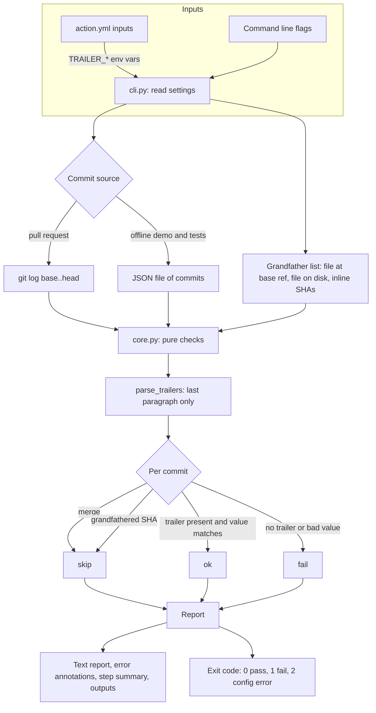

# commit-trailer-guard

**The problem:** a repository that is mirrored to a stricter server stalls the moment one commit without the required trailer line reaches the default branch, and published history cannot be rewritten to fix it.
**The fix:** stop that commit at the pull request, before it can be merged.

## What it does

A GitHub Action, backed by a dependency free Python script, that fails a pull
request when any non merge commit in it lacks a required trailer line.

- **Configurable key and value.** You choose the trailer key (for example
  `Change-Source`) and a regular expression the whole value must match.
- **Merge commits are skipped.** Only commits with one parent or none are
  checked.
- **Grandfather list.** Old SHAs that can no longer be fixed are listed in a
  file and skipped. The list is read from the pull request base, so a pull
  request cannot exempt its own commits.
- **Strict trailer parsing.** The trailer must be in the last paragraph of
  the message, and that paragraph must contain only `Key: value` lines. A
  sentence in the body that mentions the key does not count.
- **Clear failures.** Each bad commit is listed with the reason and the exact
  `git` commands to fix it, plus GitHub error annotations and a step summary.
- **Fails closed.** A bad regex, a missing range or a git error exits with
  code 2. Nothing is ever reported as a pass by accident.

A trailer is a line like this at the very end of a commit message:

```
Tune retry backoff

Double the wait between attempts, capped at five minutes.

Change-Source: human-laptop
```

## Architecture



`trailer_guard/core.py` holds every rule and touches nothing outside its
arguments. `trailer_guard/cli.py` does the git and file reading and the
reporting. `action.yml` is a thin composite wrapper that passes inputs
through environment variables.

## Run it

No install step is needed; the checker uses only the Python standard library
(3.10 or newer).

```sh
# 1. offline, against the synthetic pull request in this repo
python -m trailer_guard --from-json demo/pr_failing.json --key Change-Source

# 2. against a real checkout: check every commit on your branch that is not on main
python -m trailer_guard --key Change-Source --value-pattern "(human|bot)-[a-z0-9-]+" --base origin/main --head HEAD
```

### Use it as a GitHub Action

Copy `examples/trailer-guard.yml` into `.github/workflows/` in the repository
you want to protect:

```yaml
- uses: actions/checkout@v4
  with:
    fetch-depth: 0
    ref: ${{ github.event.pull_request.head.sha }}
- uses: your-org/commit-trailer-guard@v1
  with:
    trailer-key: Change-Source
    value-pattern: "(human|bot)-[a-z0-9-]+"
    grandfather-file: .github/trailer-grandfather.txt
```

| Input | Default | Meaning |
| --- | --- | --- |
| `trailer-key` | required | Trailer key every non merge commit must carry. Matched case insensitively. |
| `value-pattern` | `.+` | Regex the whole value must match. |
| `grandfather-file` | empty | Path of a file listing exempt SHAs, one per line, `#` for comments. |
| `grandfather-ref` | pull request base SHA | Git ref the file is read from. |
| `grandfather-shas` | empty | Extra exempt SHAs, comma or space separated. |
| `base-sha`, `head-sha` | pull request base and head | Range to check. |

Outputs: `result` (`pass` or `fail`), `checked`, `failed`, `skipped`.

Then make the check required. See
[docs/branch-protection-mirrored-repo.md](docs/branch-protection-mirrored-repo.md)
for the branch protection settings, why squash and rebase merges defeat the
check, and how to handle the grandfather list on a mirrored repository.

## Tests

```sh
python -m pip install -r requirements-dev.txt
python -m pytest
```

67 tests. The core rules are tested against fixture commit messages in
`tests/fixtures/messages/` (valid, missing, wrong value, key mentioned only in
the body, CRLF line endings, folded values and more). The command line layer
is tested with a fake git runner, so the tests need no repository and no
network. `.github/workflows/ci.yml` runs the tests on Python 3.10 and 3.12 and
checks that the demo still produces `demo/output.txt`.

## Demo

```sh
python demo/run_demo.py
```

The demo runs four scenarios over synthetic commits, fully offline. Captured
output is in [demo/output.txt](demo/output.txt). The second scenario:

```
commit-trailer-guard: require 'Change-Source: <(human|bot)-[a-z0-9-]+>'
  ok                   1a2b3c4d5e  Add intake form validation
  skip (grandfathered) 2b3c4d5e6f  Fix typo in scheduler config
  skip (merge)         3c4d5e6f70  Merge branch 'main' into feature/intake
  BAD VALUE            4d5e6f7081  Tune retry backoff
                                   -> value "Robot 7" does not match (human|bot)-[a-z0-9-]+
  MISSING              5e6f708192  Document the trailer rule
                                   -> no Change-Source trailer in the last paragraph
  ok                   6f708192a3  Regenerate API client
Checked 4 commits: 2 ok, 2 failed. Skipped 2 (1 merge, 1 grandfathered).
RESULT: FAIL
```

All commits, SHAs, names and addresses in the demo and fixtures are invented.

## Configuration

There are no secrets and no API keys. `.env.example` lists the optional
`TRAILER_*` environment variables; each has a matching command line flag
(`python -m trailer_guard --help`).

## Where this pattern runs

This is drawn from systems that run two small service companies day to day.
There, people and automated agents commit to the same repository, a trailer
records where each change came from, and the repository is mirrored to a
backup that refuses commits without it. The guard exists because a single
trailer-less commit on the default branch is enough to stop such a mirror
until the SHA is exempted by hand.

## Limitations

- **The Action itself has not been run on GitHub from this repository.** The
  Python checker, its tests and the demo run locally. `action.yml` and the
  example workflow are written to the documented composite action format but
  were not executed on a hosted runner, and the git reading path is tested
  with a fake git runner only, not against a real repository.
- **Pull request events only.** The defaults read the pull request base and
  head SHAs. Push events and merge queues are not wired up.
- **Needs full history.** The checkout must use `fetch-depth: 0`, or the
  range cannot be walked and the check exits with a configuration error.
- **Needs `python3` and `bash` on the runner.** True for GitHub hosted Linux
  and macOS runners. Windows runners are untested.
- **Stricter than git about trailers.** Git accepts a last paragraph that
  mixes trailers with some other lines; this tool does not. A commit that
  `git interpret-trailers` would accept can fail here.
- **It checks the commits in the pull request, not the commit a squash or
  rebase merge creates.** Allow merge commits only, as the branch protection
  guide explains.
- **It cannot see direct pushes.** Without branch protection the check is
  advice, not a gate.
- **Octopus and ordinary merges are both skipped** whatever their message
  says. A merge commit that also carries hand edits is not inspected.
- **The trailer is a label, not proof.** Anyone can type a valid value. This
  enforces that the line exists and is well formed, nothing more.

## License

License: MIT, see the LICENSE file.
