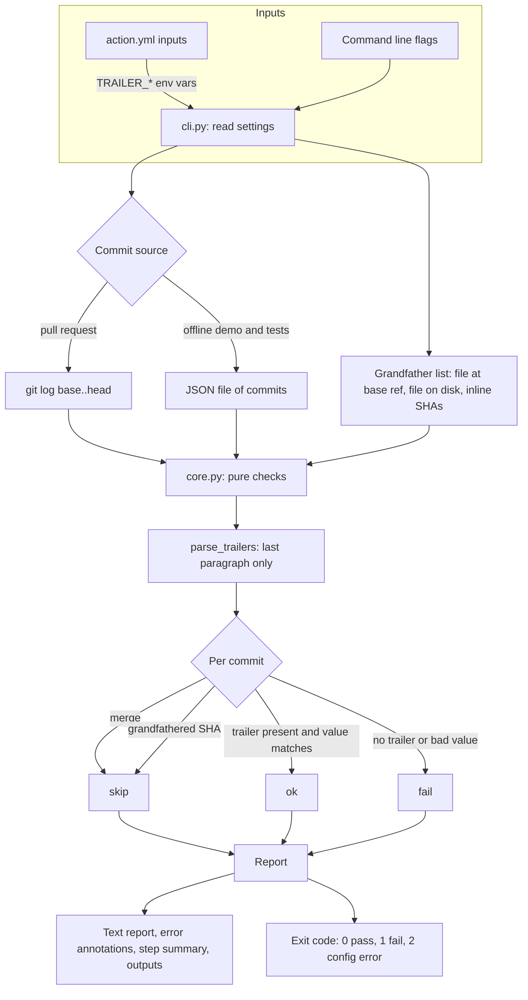

# commit-trailer-guard

Stops a pull request from merging when one of its commits is missing a
required trailer line, and tells the author exactly how to fix it.

**Who it is for:** teams that record where every change came from (a person,
a bot, an AI agent, a ticket) as a line at the end of each commit message,
and need that rule enforced instead of remembered.

**The problem it solves:** one commit without the line reaches the default
branch. Published history cannot be rewritten, so the gap is permanent, and
if the repository is mirrored to a server that rejects such commits, the
mirror stops until someone exempts the SHA by hand.

**What it does:** a GitHub Action checks every commit in the pull request,
lists each bad one with the reason and the `git` command that repairs it, and
fails the check. Under it is one small Python script with no dependencies, so
the same rule also runs on a laptop or in a server side hook.

## What you will see

Real output from `python demo/run_demo.py` (second of four scenarios, copied
from [demo/output.txt](demo/output.txt); all commits are invented):

```
$ python -m trailer_guard --from-json demo/pr_failing.json --key Change-Source --value-pattern "(human|bot)-[a-z0-9-]+" --grandfather-file demo/grandfather.txt
------------------------------------------------------------------------------
commit-trailer-guard: require 'Change-Source: <(human|bot)-[a-z0-9-]+>'
  ok                   1a2b3c4d5e  Add intake form validation
  skip (grandfathered) 2b3c4d5e6f  Fix typo in scheduler config
  skip (merge)         3c4d5e6f70  Merge branch 'main' into feature/intake
  BAD VALUE            4d5e6f7081  Tune retry backoff
                                   -> value "Robot 7" does not match (human|bot)-[a-z0-9-]+
  MISSING              5e6f708192  Document the trailer rule
                                   -> no Change-Source trailer in the last paragraph
  ok                   6f708192a3  Regenerate API client
Checked 4 commits: 2 ok, 2 failed. Skipped 2 (1 merge, 1 grandfathered).
RESULT: FAIL
How to fix:
  latest commit:  git commit --amend --no-edit --trailer "Change-Source: <value>"
  older commits:  git rebase <base> -x 'git commit --amend --no-edit --trailer "Change-Source: <value>"'
  The trailer must sit in the last paragraph of the message. Commits already on a
  protected branch cannot be rewritten; add their SHAs to the grandfather list.
exit code: 1
```

A trailer is a `Key: value` line in the last paragraph of a commit message:

```
Tune retry backoff

Double the wait between attempts, capped at five minutes.

Change-Source: human-laptop
```

## The rules

- **Configurable key and value.** You choose the trailer key (for example
  `Change-Source`) and a regular expression the whole value must match. The
  key is matched case insensitively. If a commit carries the key more than
  once, every value must match.
- **Merge commits are skipped.** Only commits with one parent or none are
  checked.
- **Grandfather list.** Old SHAs that can no longer be fixed are listed in a
  file and skipped. The Action reads the list from the pull request base, so
  a pull request cannot exempt its own commits.
- **Strict trailer parsing.** The trailer must be in the last paragraph of
  the message, and that paragraph must contain only `Key: value` lines. A
  sentence in the body that mentions the key does not count.
- **Clear failures.** Each bad commit is listed with the reason and the
  `git` commands to fix it, plus GitHub error annotations and a step summary.
- **Configuration errors do not pass.** A bad regex, a missing or unknown
  revision, a malformed grandfather list or a git error exits with code 2.

Exit codes: 0 pass, 1 at least one bad commit, 2 configuration error.

## Run it

No install step is needed; the checker uses only the Python standard library
(3.10 or newer).

```sh
# 1. offline, against the synthetic pull request in this repo (exits 1)
python -m trailer_guard --from-json demo/pr_failing.json --key Change-Source --value-pattern "(human|bot)-[a-z0-9-]+"

# 2. against a real checkout: check every commit on your branch that is not on main
python -m trailer_guard --key Change-Source --value-pattern "(human|bot)-[a-z0-9-]+" --base origin/main --head HEAD
```

### Use it as a GitHub Action

Copy `examples/trailer-guard.yml` into `.github/workflows/` in the repository
you want to protect. The steps that matter:

```yaml
- uses: actions/checkout@v7
  with:
    fetch-depth: 0
    ref: ${{ github.event.pull_request.head.sha }}
- uses: your-org/commit-trailer-guard@<commit-sha>
  with:
    trailer-key: Change-Source
    value-pattern: "(human|bot)-[a-z0-9-]+"
    grandfather-file: .github/trailer-grandfather.txt
```

Replace `your-org` with the owner hosting this repository and `<commit-sha>`
with a full commit SHA. No release tag has been published, so there is no
`@v1` to point at.

| Input | Default | Meaning |
| --- | --- | --- |
| `trailer-key` | required | Trailer key every non merge commit must carry. Matched case insensitively. |
| `value-pattern` | `.+` | Regex the whole value must match. |
| `grandfather-file` | empty | Path of a file listing exempt SHAs, one per line, `#` for comments. |
| `grandfather-ref` | pull request base SHA | Git ref the file is read from. |
| `grandfather-shas` | empty | Extra exempt SHAs, comma or space separated. |
| `base-sha`, `head-sha` | pull request base and head | Range to check. |

Outputs: `result` (`pass` or `fail`), `checked`, `failed`, `skipped`. They
are not set when the run ends in a configuration error.

Then make the check required. See
[docs/branch-protection-mirrored-repo.md](docs/branch-protection-mirrored-repo.md)
for the branch protection settings, why squash and rebase merges defeat the
check, and how to handle the grandfather list on a mirrored repository.

## Tests

```sh
python -m venv .venv
.venv/bin/python -m pip install -r requirements-dev.txt    # Windows: .venv\Scripts\python
.venv/bin/python -m pytest
```

71 tests.

- The rules are tested against fixture commit messages in
  `tests/fixtures/messages/` (valid, missing, wrong value, key mentioned only
  in the body, CRLF line endings, folded values and more).
- The command line layer is tested with a fake git runner.
- `tests/test_real_git.py` builds a real repository in a temp folder (with a
  merge, a legacy commit and a pull request that tries to exempt itself) and
  runs the real `git log` and `git show` path. It is skipped if git is not
  installed.

`.github/workflows/ci.yml` runs the tests on Python 3.10 and 3.12, checks
that the demo still produces `demo/output.txt` byte for byte, and runs
`action.yml` itself on a GitHub hosted Ubuntu runner against a scratch
repository, once expecting a pass and once expecting a failure.

## Demo

```sh
python demo/run_demo.py
```

Four scenarios over synthetic commits, fully offline: a failing pull request,
the same one with a grandfather list, a clean one, and a broken regex that
must exit 2. Full captured output is in [demo/output.txt](demo/output.txt).
All commits, SHAs, names and addresses in the demo and fixtures are invented.

## Architecture



`trailer_guard/core.py` holds every rule and touches nothing outside its
arguments. `trailer_guard/cli.py` does the git and file reading and the
reporting. `action.yml` is a thin composite wrapper that passes inputs
through environment variables, never through the script text.

## Configuration

There are no secrets and no API keys. `.env.example` lists the optional
`TRAILER_*` environment variables; each has a matching command line flag
(`python -m trailer_guard --help`). The script does not load a `.env` file
itself; export the variables or pass the flags.

## Where this pattern runs

This is drawn from systems that run two small service companies day to day.
There, people and automated agents commit to the same repository, a trailer
records where each change came from, and the repository is mirrored to a
backup that refuses commits without it. This repository is a standalone
rewrite of that rule for public use, not the code that runs there.

## Limitations

- **Never run on a real pull request.** CI runs `action.yml` on a hosted
  Ubuntu runner, but against a scratch repository with the base and head SHAs
  passed in by hand. The default SHAs taken from a `pull_request` event, pull
  requests from forks, and use as a required check under branch protection
  have not been exercised. Nothing has been run against a real mirror.
- **The server side hook in the guide is a sketch.** It has not been run.
- **Not published.** No release tag and no Marketplace listing; pin a commit
  SHA.
- **Pull request events only.** Push events and merge queues are not wired
  up.
- **Needs full history.** The checkout must use `fetch-depth: 0`. With the
  default shallow checkout the base commit is absent and the check exits
  with a configuration error.
- **An empty range passes.** If `base..head` holds no commits (for example
  the two were swapped), the result is a pass with "no commits in range".
- **A stale base widens the range.** The range starts at the base SHA GitHub
  recorded for the pull request. If the branch has since merged a newer
  default branch, those newer commits are checked too, against the
  grandfather list as it was at the recorded base.
- **Needs `python3` (3.10 or newer) and `bash` on the runner.** Tested on
  `ubuntu-latest` only. macOS and Windows runners are untested; the tests
  and demo also pass locally on Windows with Python 3.12.
- **Stricter than git about trailers.** Git accepts a last paragraph that
  mixes trailers with some other lines (a `(cherry picked from ...)` line,
  for instance); this tool does not. A commit that `git interpret-trailers`
  would accept can fail here.
- **It checks the commits in the pull request, not the commit a squash or
  rebase merge creates.** Allow merge commits only, as the branch protection
  guide explains.
- **It cannot see direct pushes.** Without branch protection the check is
  advice, not a gate.
- **All merge commits are skipped** whatever their message says. A merge
  commit that also carries hand edits is not inspected.
- **Short grandfather prefixes are a hole.** A 7 character prefix exempts any
  commit whose SHA starts with it, and such a SHA can be produced on purpose.
  Use full 40 character SHAs.
- **The trailer is a label, not proof.** Anyone can type a valid value. This
  enforces that the line exists and is well formed, nothing more.

## License

License: MIT, see the LICENSE file.
