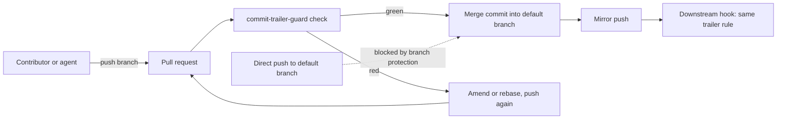

# Branch protection for a mirrored repository

This guide covers one specific setup: a repository on GitHub whose default
branch is mirrored to a second git server, where the second server refuses
commits that lack a required trailer.

## Why the mirror makes this strict

A mirror copies history exactly. If the downstream server has a hook that
rejects a commit, it rejects every later push too, because each later push
still contains the bad commit. One trailer-less commit on the default branch
therefore stops the mirror until someone either rewrites published history
(usually unacceptable) or adds an exemption for that SHA by hand on the
downstream side.

The fix is to make it impossible for such a commit to reach the default
branch in the first place. The pull request check in this repository is the
gate; branch protection is what makes the gate mandatory.



## Settings to apply

Apply these to the default branch, using either a branch protection rule or a
repository ruleset. Names below follow the GitHub web interface.

1. **Require a pull request before merging.** This removes direct pushes,
   which the check can never see.
2. **Require status checks to pass before merging**, and select the job that
   runs this action. With the example workflow the check is named
   `trailers`. A check can only be selected after it has run at least once,
   so open one pull request with the workflow first.
3. **Do not allow bypassing the above settings.** In a classic rule this is
   "Do not allow bypassing the above settings" (older wording: "Include
   administrators"). In a ruleset, leave the bypass list empty. Most
   incidents come from an owner or an automation token that was allowed to
   skip the rule "just this once".
4. **Block force pushes and branch deletion** on the default branch. A
   mirror cannot follow rewritten history cleanly.
5. **Allow merge commits only.** In the repository's general settings, turn
   off "Allow squash merging" and "Allow rebase merging". This matters more
   than it looks:
   - A squash merge creates a brand new commit on the default branch. Its
     message is built from the pull request title and body, so it will not
     carry the trailer unless someone types it into the merge dialog. The
     check ran on the branch commits, which are then thrown away.
   - A rebase merge rewrites every commit with a new SHA. The messages are
     kept, so trailers survive, but the SHAs that were checked are not the
     SHAs that land.
   - A merge commit keeps the checked commits exactly as they were and adds
     one merge commit, which the rule skips by design.

## What the downstream hook should agree on

The two sides must enforce the same rule or they will disagree at the worst
moment. Keep these three things identical:

- the trailer key and value pattern
- the treatment of merge commits (skipped on both sides)
- the grandfather list

The same Python script can run in a server side hook. A sketch, not tested
as part of this repository:

```sh
#!/bin/sh
# pre-receive: stdin has "<old> <new> <ref>" per pushed ref
while read old new ref; do
  [ "$ref" = "refs/heads/main" ] || continue
  PYTHONPATH=/opt/commit-trailer-guard python3 -m trailer_guard \
    --key Change-Source --value-pattern '(human|bot)-[a-z0-9-]+' \
    --grandfather-file /etc/trailer-guard/grandfather.txt \
    --base "$old" --head "$new" || exit 1
done
```

## Grandfathering old commits

Commits that reached the default branch before the rule existed cannot be
fixed. List their SHAs in a grandfather file (see
`examples/trailer-grandfather.txt`).

- Use full 40 character SHAs. Prefixes of 7 or more characters work but a
  short prefix can match a future commit by accident.
- Add a comment with the date and the reason on every line.
- Changing the list is a policy change. Review it like one: require a code
  owner review on the file.
- The action reads the list from the pull request **base** by default
  (`grandfather-ref`), not from the pull request branch. A pull request
  therefore cannot exempt its own commits. The cost is that a new entry only
  takes effect after the change to the list has itself been merged.
- Grandfather the same SHAs on the downstream server at the same time.

## Recovery when a bad commit lands anyway

It can still happen: a setting was relaxed, or a token with bypass rights
pushed directly.

1. Do not force push the default branch to "fix" the message. That breaks
   every clone and the mirror.
2. Add the SHA to the grandfather list on both sides, with a comment.
3. Find out which setting allowed it and close that path.
4. Check that the mirror resumes on the next push.

## Things this setup does not cover

- **Merge queues.** A merge queue creates its own temporary commits and runs
  checks on `merge_group` events. This action reads pull request base and
  head SHAs, so it has not been wired up or tested for merge queues.
- **Tags and other branches.** Protection applies to the branches you name.
  If the mirror copies all refs, protect or exclude the others.
- **Commits made in the GitHub web editor** follow the same rule as any
  other commit: on a protected branch they go through a pull request and
  need the trailer in the message.
